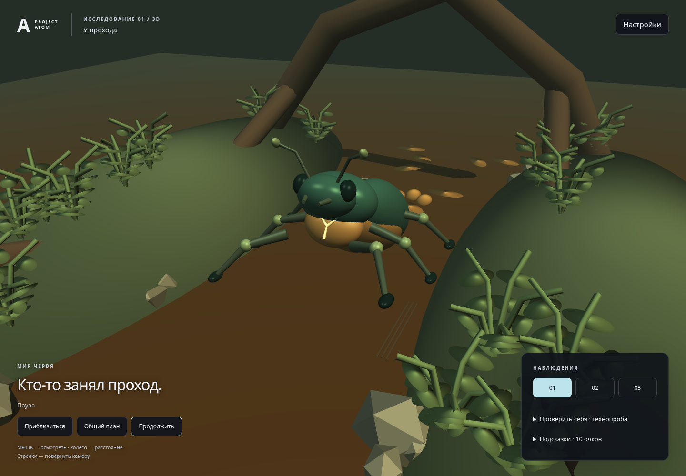

# Атомная бомба против умирающего червя

[ТЗ и решения по игре](PROJECT_KNOWLEDGE.md) описывают концепцию, согласованные требования, результаты тестов и открытые вопросы.

## 3D-технопроба на Babylon.js



Текущая работа — в ветке `spike/beetle-3d`. Это отдельная сцена для проверки объёмного жука и различимости жестов: машет, стучит, скребёт. Полная голосовая эстафета остаётся в старом `game.html` ниже. `main` и `dev` не обновлялись.

Нужен **Node.js 24 LTS** (или Node.js 22.18+). После установки Node заново открой терминал. Из папки проекта:

```bash
git fetch origin
git switch spike/beetle-3d
npm ci
npm run dev
```

Открой адрес, который напишет Vite (по умолчанию `http://127.0.0.1:5173`). Нажми «Осмотреть место». Перетаскивай сцену мышью, приближай колесом; кнопки «Приблизиться» и «Общий план» возвращают удобные ракурсы. Переключатели 01–03 показывают три наблюдения. Текущий жест текстом не назван: сначала посмотри, затем по желанию раскрой «Проверить себя · технопроба». Настройки открываются в одном центральном окне: «Звук» содержит выключатель и общую громкость, «Видео» — параметры изображения и качество сцены. Звук по умолчанию выключен.

Для повторения одинакового набора открой страницу с `?seed=12`. Во время проверки с партнёром сначала опиши движение и знак голосом; не зачитывай варианты ответа. Это ещё не полноценный матч с ролями.

Остановка сервера: `Ctrl+C`. Для готовой сборки:

```bash
npm run build
npm run preview
```

Готовые файлы находятся в `dist/`; всю папку можно передать на другой компьютер и запустить там локальную раздачу файлов. Открытие HTML двойным щелчком для этой версии не поддерживается. После установки зависимостей сборка и сама сцена не требуют внешних сервисов: модели, текстуры и звук создаются локально.

Карта модулей и порядок будущей замены модели на Blender/GLB: [docs/ARCHITECTURE.md](docs/ARCHITECTURE.md).

Проверки разработчика:

```bash
npm run test:unit
npm run build
npx playwright install chromium
npm test
```

В облачной среде уже установлен системный Chromium; вместо загрузки браузера используется `PLAYWRIGHT_CHROMIUM_EXECUTABLE_PATH=/usr/bin/chromium npm test`. Эти проверки не измеряют скорость игры на компьютерах игроков. Форматирование кода: `npm run format`.

## Эталон времени и предыдущий 2D-макет

[sync-stand.html](sync-stand.html) содержит исходный код стенда и запускается как самостоятельная HTML-страница. Для проверки открой файл в браузере на Windows и Mac, создай код на одном устройстве и введи его на другом. Интернет-время выбрано по умолчанию и обращается к UTCTime перед стартом. Системные часы и ручной запуск доступны в меню создания теста.

Для продолжения разработки начни с разделов 6 и 11 ТЗ и сохрани рабочее поведение трёх режимов. Этот стенд можно использовать как эталон при переносе логики времени в игру.


## Первый игровой макет

Открой `game.html` на каждом компьютере (один и тот же файл). Игрок 1 выбирает «оператор», режим старта и создаёт глобальный сид. Игрок 2 выбирает «червь» и вставляет весь полученный сид. Для ручного режима оба нажимают «Начать» под голосовой отсчёт. Для системного/интернет-времени дождитесь старта. Интернет-время требует доступа к `https://utctime.app`; при ошибке можно явно создать новую игру в другом режиме.

Дальше общайтесь голосом: червь описывает знак и жест жука, оператор ищет инструкцию на компьютере. После открытия прохода червь сообщает маркировку кабеля, оператор подключает подготовленный прибор. Сведения для следующей поляны завершают этот макет. Между экземплярами нет обмена игровыми данными. Перезагрузка сбрасывает попытку. Это схематичный 2D-макет; полная игра остаётся 3D.

Рабочие ветки: `main` — более готовый продукт, `dev` — разработка, `mvp/beetle-relay` — предыдущий 2D-эксперимент, `spike/beetle-3d` — текущая технопроба. Макеты пока не перенесены в `dev` или `main`.

При необходимости запусти локальную раздачу файлов из каталога проекта: `python3 -m http.server 8000`. Затем открой `game.html` через этот сервер на том же компьютере. Сервер только раздаёт файлы.

Проверка разработчика: `python3 tests/smoke.py`. Нужны Python Playwright и Chromium (по умолчанию `/usr/bin/chromium`, можно указать `CHROMIUM_PATH`). Проверки запускают временный локальный HTTP-сервер и два изолированных браузерных контекста; UTCTime в тесте имитируется. Это не заменяет голосовой прогон на Windows + Mac.

## Версия 0.8: видео и подсказки

Во вкладке «Видео» — выпадающие параметры, контекстное описание и фактический FPS. Изменения сначала остаются в форме: справа под описанием нажми «Применить настройки». Текущий предел и расчёт после применения показаны отдельно. Переключение вкладок, закрытие окна и повторное открытие не применяют изменения. Кнопка сброса и F8 возвращают значения формы по умолчанию; затем также нужно нажать «Применить». Звук и громкость меняются сразу. Esc, крестик или щелчок по фону закрывают окно.

Вместо фиксированных пределов используется измеренная базовая частота X. Множители: HairWorks ×0,7, Ray Tracing ×0,2, Path Tracing ×0,3, PhysX ×0,9. Они перемножаются: при X=165 RT+PT даёт 9,9 FPS. Генерация ×2/×3/×4 и режимы DLSS / FSR / XeSS компенсируют потери, но не создают частоту выше доступной без ограничений. Коэффициенты — параметры эксперимента, не реальные бенчмарки SDK. Подробности и ссылки на официальные материалы — [модель FPS](docs/design/FPS.md).

Базовая частота измеряется при активной видимой сцене без искусственного лимита и фиксируется после короткого замера. Реальное изменение качества сцены требует нового замера. Во время начального замера ограничения временно не действуют. Счётчик всегда показывает реальные вызовы отрисовки; на паузе — «Пауза». Настройки и черновик формы сбрасываются после перезагрузки.

Подсказки открываются только по запросу: общий запас 10, три последовательных уровня события beetle по одному очку. Наблюдения 01–03 — варианты одного события; открытые уровни читаются бесплатно, при смене варианта третий уровень обновляет признаки. Максимальный расход здесь 3, остаток 7. Бесплатного текстового ответа в настройках нет. Перезагрузка сбрасывает графику и подсказки.

Обновление в Windows PowerShell (после сохранения собственной работы):

```powershell
git fetch origin
git switch spike/beetle-3d
git pull --ff-only origin spike/beetle-3d
npm.cmd ci
npm.cmd run dev
```

Снимки обновлённого меню: [графика](docs/images/graphics-settings.png), [узкий экран](docs/images/graphics-narrow.png), [звук](docs/images/sound-settings.png).

Визуальное направление меню «Видео», источники и ограничения исследования: [docs/design/VIDEO.md](docs/design/VIDEO.md). Палитра интерфейса — графитовая с красным акцентом и голубыми значениями. Шуточные надписи удалены; сведения о пределах FPS пока оставлены по запросу пользователя.
