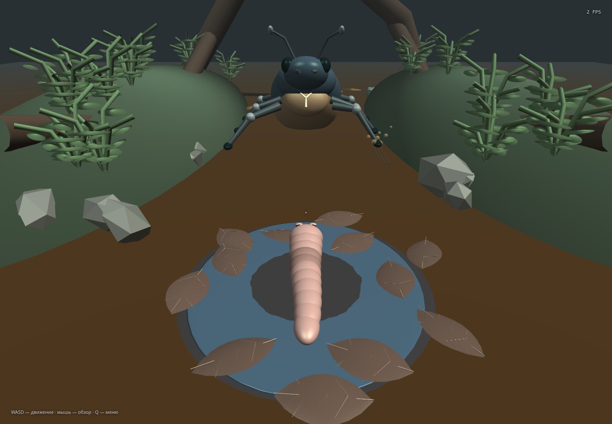

# ProjectAtom

Асимметричная кооперативная 3D-игра про оператора, вымышленную атомную бомбу и выживающего червя. Требования и решения — [PROJECT_KNOWLEDGE.md](PROJECT_KNOWLEDGE.md).

## Управляемый червь — технодемка 0.9

Рабочая ветка: `spike/worm-third-person`. [Контекст восстановления и контрольные сохранения](docs/HANDOFF.md) — первый файл для продолжения после потери чата.



Это локальный фрагмент для проверки управления: червь движется по земляному проходу, жук перекрывает дорогу. Можно подойти, осмотреть жука, положить подстилку сбоку и увидеть, как он подбирает её и уходит. Полная голосовая эстафета, выбор ролей, общий пакет старта, лечение и финал в эту 3D-версию ещё не перенесены.

### Пролог червя

На стартовом экране нажми **«Пролог червя · со звуком»**: примерно 2 минуты 14 секунд под авторскую **WormTheme** из MIDI пользователя. Бледноватый коричневый червь кашляет в луже; крупная ворона подхватывает его клювом и взлетает, орёл нападает, затем червь молча падает **35 секунд**, плавно изгибаясь и медленно вращаясь, с ускорением пролетает облачные слои и снова остаётся в той же луже без отскока. Последние ноты звучат на лежащего червя; затем включается управление.

**Пробел** — пропустить, **Q** — меню; время продолжает идти. Общая громкость и выключатель звука действуют и на пролог. Прежняя кнопка «Начать технодемку» запускает игру сразу. [Постановка и тайминг](docs/design/CINEMATICS.md), [MIDI и повторный рендер фортепиано](assets/music/README.md). Исходное исполнение сохранено в `assets/music/source/WormTheme.mid`; в браузере используется локальный Ogg, не синтез старого мотива.

Во время полёта есть боковые крупные планы червя в клюве (40–44 и 58–63 с). Падение ускорено за счёт условной высоты сцены: длительность и музыка не растягиваются. Возврат к игровой позе идёт постепенно с 120-й секунды до конца, сначала голова, затем хвост.

Это постановочная проба на процедурных моделях: добавлены умеренная бледность, тяжёлые веки, крупные птицы с суставными крыльями, позы и анимации; цвет червя одинаков в прологе и управлении, переход света плавный; полноценный художественный редизайн и общая палитра будут обсуждаться после референса пользователя. Пока модель немного тоньше, а цвет теплее и ближе к коричневому. [Кадр пролога](docs/images/worm-prologue.png). После завершения и проверки задачи обновляем MD, создаём итоговый коммит и отправляем его в рабочую ветку. Промежуточные сохранения — только по отдельной просьбе.

### Запуск на Windows

Нужен Node.js 24 LTS (либо >=22.18). Из каталога репозитория в PowerShell, после сохранения своих изменений:

```powershell
git fetch origin
git switch spike/worm-third-person
git pull --ff-only origin spike/worm-third-person
npm.cmd ci
npm.cmd run dev
```

Открой адрес Vite (обычно `http://127.0.0.1:5173`) и нажми «Начать технодемку». Браузер захватит указатель мыши. Если захват запрещён, меню предложит повторить его кнопкой «Продолжить игру»; для встроенного окна могут требоваться разрешения браузера.

| Управление | Действие |
| --- | --- |
| WASD | Движение червя относительно направления камеры |
| Мышь без удержания кнопки | Обзор от третьего лица |
| E около жука | Положить подстилку сбоку |
| Q | Открыть/закрыть маленькое меню |
| «Настройки» в меню | Открыть большое окно «Звук / Видео» |

В игре нет кликабельных кнопок камеры, паузы и настроек. В меню мышь свободна; «Продолжить игру» возвращает захват. Из настроек Q, крестик или фон возвращают в маленькое меню. Escape остаётся резервным освобождением указателя; повторный захват запускается только через Q или «Продолжить игру». «Выйти из игры» завершает попытку и возвращает стартовый экран, не закрывая вкладку браузера.

Червь поворачивает голову постепенно, а сегменты тела и хвост следуют по её фактическому пути; весь персонаж больше не разворачивается одним жёстким объектом. Камера переносится вместе с червём и сохраняет заданный мышью ракурс при движении. Q обрабатывается по физической клавише, независимо от раскладки.

Меню **не останавливает время**: анимации и отсчёт запущенной попытки продолжаются в нём и в настройках. Скрытие вкладки очищает ввод движения, но не останавливает часы. Это ещё не синхронизация двух клиентов: общий старт матча и три режима времени остаются в прежних макетах. Сон ОС и пользовательский прогон Windows/Mac отдельно не подтверждены.

Подстилка — одно локальное техническое действие без подбора материала и операторского справочника: она проверяет последовательность подхода, подбора и ухода жука. Это не готовая загадка полной игры. Столкновения ограничивают червя проходом и жуком; камера приближается перед крупными препятствиями. Модели процедурные, полноценной физики, GLB-рига и биомеханики пока нет.

### Настройки и помощь

«Звук»: включение музыки/эффектов и общая громкость 0–100%, действуют сразу. «Видео»: множители от измеренного базового FPS, апскейлеры, генерация кадров, реальное качество сцены и ручной лимит. Изменения сначала остаются в форме и действуют только после **«Применить настройки»** справа. F8/сброс также требуют применения. Смена вкладки и закрытие не применяют форму автоматически. Подробности — [модель FPS](docs/design/FPS.md), [визуальное направление](docs/design/VIDEO.md).

Настройки сохраняются между попытками до перезагрузки страницы. Выход и новый запуск сбрасывают положение червя, действие подстилки, время и подсказки. В меню по запросу доступны 10 очков помощи и 3 последовательных уровня события beetle: каждый новый стоит одно очко, повторное чтение бесплатно. «Техническая проверка» в меню содержит три варианта наблюдения и проверку ответов. Обычный игровой HUD не выдаёт знак, жест или решение. `?seed=12` воспроизводит набор наблюдений.

Снимки: [маленькое меню](docs/images/pause-menu.png), [уход жука](docs/images/beetle-departure.png), [видео](docs/images/graphics-settings.png), [звук](docs/images/sound-settings.png).

### Сборка и проверки

```sh
npm ci
npm run test:unit
npm run build
PLAYWRIGHT_CHROMIUM_EXECUTABLE_PATH=/usr/bin/chromium npm test
```

Последняя строка — для Linux-среды с системным Chromium. На обычном компьютере установи браузер через `npx playwright install chromium`, затем `npm test`. Тесты работают с производственной сборкой через Vite preview, а не только с исходниками. Проверки и их актуальные результаты записываются в HANDOFF; не переносить успех старого прогона на новый код.

`npm run build` создаёт папку `dist/`, `npm run preview` запускает её локально. Можно перенести всю папку и раздавать локальным HTTP-сервером. Открытие `dist/index.html` через `file://` не поддерживается. Модели, текстура, шрифт и синтез звука локальные; публичный игровой сервер и внешние запросы для этой демки не нужны. Форматирование: `npm run format`. [Архитектура](docs/ARCHITECTURE.md).

## Предыдущие макеты

- `sync-stand.html` — эталон трёх режимов времени: UTCTime по умолчанию, системные часы, ручной старт. Пользователь проверял его на Windows/Mac.
- `game.html` — прежняя 2D-голосовая эстафета с обеими ролями, общим сидом, выбором подстилки, проходом к еде и подключением прибора. Это схематичный макет, не новая 3D-версия. Проверки: `python3 tests/smoke.py` (Python Playwright + Chromium).
- `spike/beetle-3d` — предыдущая отдельная сцена осмотра и настроек; базовый коммит нового этапа — 8658664.

`main` остаётся для более готового продукта, `dev` — для разработки; экспериментальные ветки не сливаются в них автоматически. Следующий шаг после пользовательской проверки червя — проектирование жизненного цикла, главного меню и начала полноценной игры, без преждевременного добавления сервера, аккаунтов или облачного ИИ.

Проверка исправлений управления: 22 модульных теста и сборка прошли; проверены 11 браузерных сценариев прицельными и регрессионным запусками. [Снимок поворота тела](docs/images/worm-turn.png).
